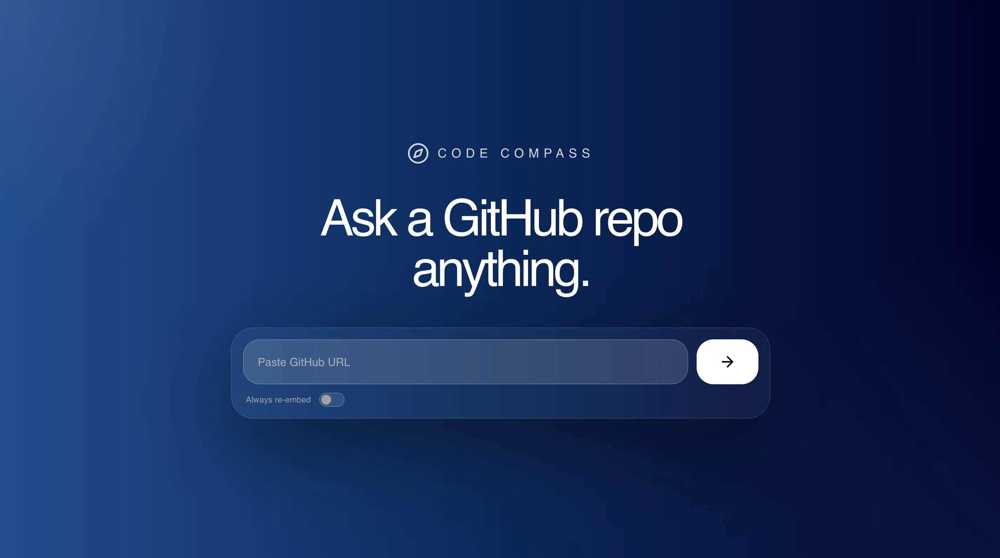
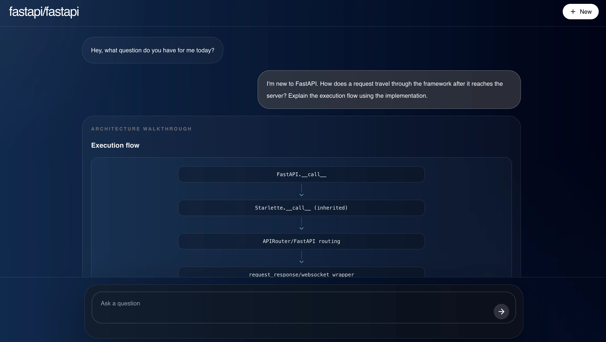
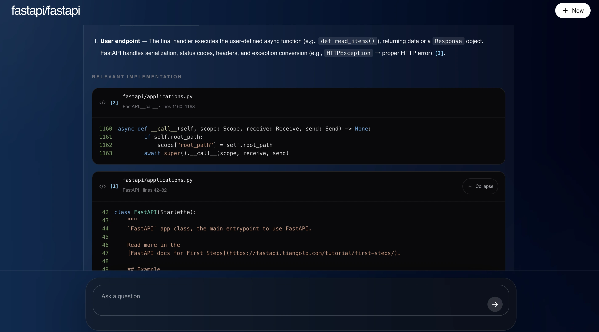
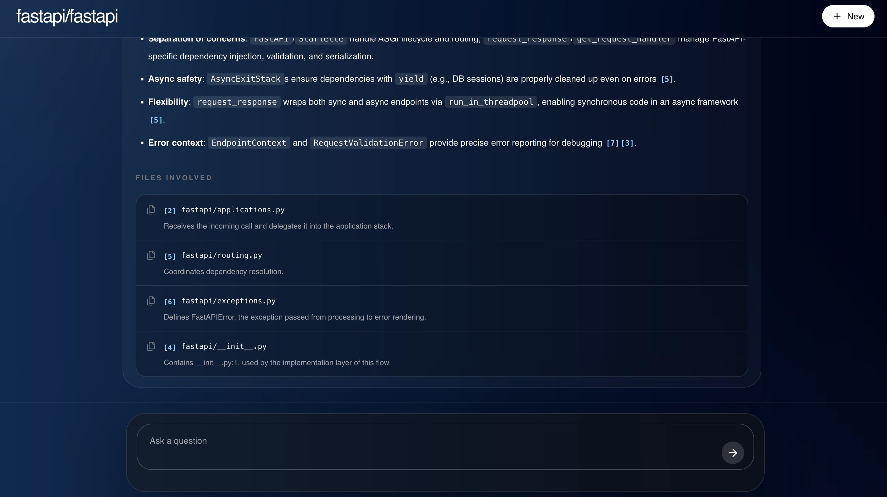
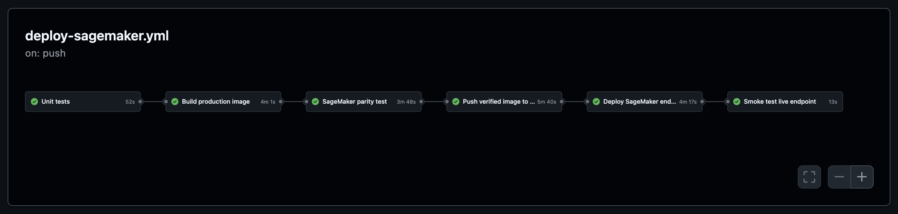
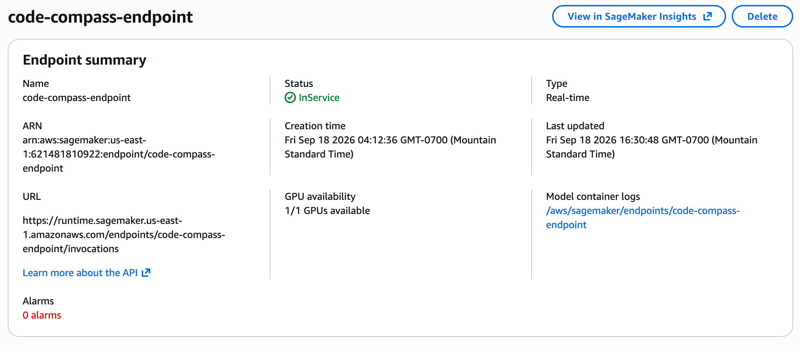
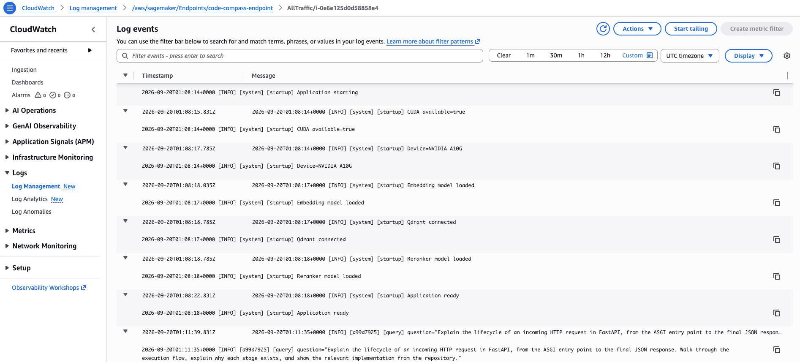
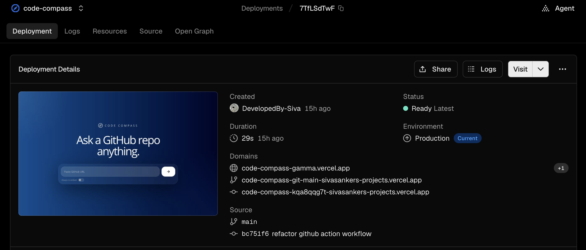

# Code Compass

**Explore unfamiliar GitHub repositories with answers grounded in their source code.**

Code Compass indexes public repositories, retrieves and reranks relevant code, and answers questions with file and line citations.



### Product screenshots



<table>
  <tr>
    <td></td>
    <td></td>
  </tr>
</table>

## Retrieval evaluation

The verified 120-query benchmark compares dense vector retrieval with hybrid retrieval and reranking across FastAPI, Django, and Documenso (40 queries per repository). Both methods use the same indexed repository data, queries, ground truth, and cutoff.

| Metric | Vector-only | Hybrid + reranking |
|---|---:|---:|
| Hit@1 | 52.5% | **70.8%** |
| Hit@5 | 78.3% | **88.3%** |
| Hit@8 | 85.8% | **92.5%** |
| MRR@8 | 0.63 | **0.78** |

Hit@K measures whether a relevant file appears in the first K results. MRR@8 is the mean reciprocal rank of the first relevant result within the first eight. Relevance is defined by the evaluation set’s expected file paths and directories. The benchmark implementation calculates these metrics from retrieval rankings; it does not encode the table values. Answer-quality scores and stage-level retrieval diagnostics use a separate report and do not affect these headline metrics. See [evaluation methodology and reproduction](docs/evaluation.md).

## How it works

```text
Public GitHub repository
    │
    ▼
Clone + code-aware parse
    │
    ├──► Symbol-aware chunks ──► Qwen3 embeddings ──► Qdrant Cloud
    └──► BM25 lexical index

Developer question
    │
    ▼
React app on Vercel
    │  OIDC-authenticated InvokeEndpoint
    ▼
SageMaker endpoint ──► FastAPI service
                            │
                            ├──► Qdrant semantic search
                            ├──► BM25 + path and intent signals
                            ▼
                      Fusion + reranking
                            │
                            ▼
                    Evidence selection
                            │
                            ▼
                 Amazon Bedrock generation
                            │
                            ▼
             Answer with validated citations
```

The indexer uses Tree-sitter to split code around symbols, with bounded fallback chunks for other files. Retrieval combines dense search, BM25, path and intent signals, then Reciprocal Rank Fusion and model reranking. The generation step receives selected evidence and returns validated citations. Qdrant keeps branch-aware repository indexes available across sessions.

Index rebuilds are written as a new Qdrant generation and activated after indexing completes, preserving the previous working cache if a rebuild fails. Session metadata and the BM25 index stay in process memory, so the reference service uses one backend worker. The embedding and reranking models run locally on the SageMaker GPU endpoint; Bedrock handles answer generation.

Vercel serves the React app and a same-origin API adapter; GitHub Actions validates the container and deploys through OIDC. The deployment guide covers [architecture, CI/CD, AWS setup, and operations](docs/deployment.md).

### Deployment evidence

| GitHub Actions CI/CD | SageMaker endpoint |
|---|---|
|  |  |

| CloudWatch logs | Vercel deployment |
|---|---|
|  |  |

## Local development

Prerequisites: Python 3.11+, Node.js 18+, a reachable Qdrant instance, and AWS credentials with access to the configured Bedrock model. Embedding and reranking models are downloaded on first use; CUDA is recommended.

1. Configure backend settings in `server/.env` (start from [`server/.env.example`](server/.env.example)). At minimum set `QDRANT_URL`, `QDRANT_API_KEY` when required, and `AWS_REGION`.
2. Start the backend:

   ```bash
   python3 -m venv .venv
   source .venv/bin/activate
   pip install -r server/requirements.txt
   cd server
   PORT=8000 python server_app.py
   ```

3. In another terminal, start the UI:

   ```bash
   cd ui
   npm ci
   cp .env.example .env
   npm start
   ```

Open `http://localhost:3000`. Local UI configuration points to the backend at `http://localhost:8000`. See [deployment and operations](docs/deployment.md) for environment variables, API examples, and production setup.

## Limitations

- Only public GitHub repositories are supported.
- Session metadata and BM25 state are process-local; the reference service uses one backend worker.
- Indexing is on demand, and large repositories take longer to parse and embed.
- The system does not construct a call graph or dependency graph.

## Project documentation

- [Evaluation methodology and commands](docs/evaluation.md)
- [Deployment and operations guide](docs/deployment.md)
- [Backend configuration example](server/.env.example)
- [Frontend configuration example](ui/.env.example)
